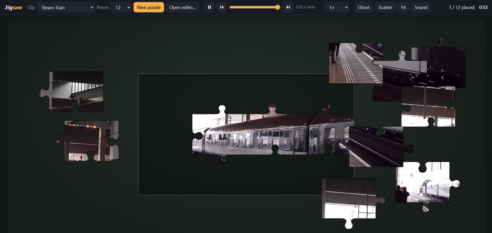

# Jigsaw

A jigsaw puzzle game where the pieces show short video clips instead of a still picture.



Each puzzle is a video, typically a few seconds long and looping, cut into classic jigsaw pieces. Every piece keeps playing its part of the clip as you drag it around the board. To solve the puzzle you match shapes and edges like a normal jigsaw, and you also use the motion: a passing car, a wave or a swinging arm moves from one piece into the next, so you can see which pieces belong together.

## Features

- **Pieces that play video**: every piece shows its own part of the clip.
- **Motion as a clue**: follow movement across edges to find matching pieces.
- **Adjustable difficulty**: pick the number of pieces, from a quick 12-piece puzzle to a 500-piece challenge.
- **Your own clips**: load your own short videos and turn them into puzzles.
- **Pause and scrub**: freeze the video or step through it to line up tricky pieces.

## How to play

1. Choose a video clip and a piece count.
2. The clip is cut into pieces and scattered across the board.
3. Drag the pieces into place. Matching pieces snap together.
4. The puzzle is solved when the whole video plays seamlessly.

## Running it

- **Windows PC**: double-click `Jigsaw.bat`. It refreshes the video list and opens the game in its own Microsoft Edge window. Without Edge it falls back to your default browser.
- **Any browser**: open `index.html`. No install or build step is needed.

You can link straight to a puzzle with URL options, for example `index.html?clip=reef&pieces=100`.

## Controls

| Action | Mouse / touch | Keyboard |
| --- | --- | --- |
| Move a piece or group | Drag it | |
| Zoom | Scroll wheel / pinch | `+` / `-` |
| Pan the table | Drag empty space | |
| Fit table to window | **Fit** | `F` |
| Play / pause | ▶ / ❚❚ | `Space` |
| Step one frame | ⏮ / ⏭ | `←` / `→` |
| Scrub | Position slider | |
| Show the video faintly on the board | **Ghost** | `G` |
| Scatter loose pieces | **Scatter** | `S` |
| New puzzle | **New puzzle** | `N` |

Pieces join when you drop them next to a matching neighbour, and lock in place when dropped near their spot on the board. Best times are saved per clip and piece count.

## Videos

The clip menu has three sources:

- **Built-in clips**: four looping scenes drawn in code (Sunset Sea, Night Traffic, Coral Reef, Neon Bloom), so the game works with no files at all.
- **Videos folder**: every video in `videos/`. Add `.mp4`, `.webm`, `.m4v`, `.mov` or `.ogv` files there, then start the game with `Jigsaw.bat`, or run `tools/scan-videos.ps1` to refresh `videos/library.js`. Browsers can't list a folder themselves, so the game reads that file. File names become titles: `Beach_waves.mp4` shows as "Beach waves".
- **Your videos**: use **Open video…** or drop a video file onto the page.

Short clips (5–20 seconds) with lots of movement and varied colour make the best puzzles. Very large videos are scaled down to 1280 px wide.

`videos/` includes three real clips from Wikimedia Commons: Aquarium Fish, Grand Canyon Clouds and Steam Train. All three are under CC BY-SA. Authors, licences and source links are in [videos/CREDITS.md](videos/CREDITS.md). Keep that file with the clips if you share them.

The other example videos are generated with ffmpeg's built-in generators (fractal zoom, Game of Life, plasma, gradients, Sierpinski carpet). To recreate them, run `tools/make-example-videos.ps1` (needs ffmpeg: `winget install Gyan.FFmpeg`).

## Project layout

```
index.html, style.css     page and styling
js/pieces.js              jigsaw piece shapes (shared edges, so neighbours fit exactly)
js/clips.js               the built-in clips, drawn on a canvas
js/game.js                game logic: board, dragging, snapping, playback, win
videos/                   video library + generated library.js
tools/                    scan-videos.ps1, make-example-videos.ps1
Jigsaw.bat                Windows launcher
```

## Tech

- Source on GitHub: https://github.com/jjkramhoeft/jigsaw-clip
- Playable in browser or windows PC
- Videos should live in a folder, find some examples for a start
